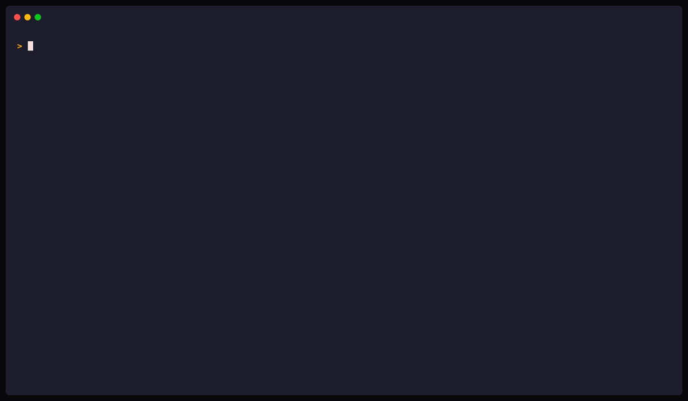

# Installation

Install gridctl on macOS, Linux, or WSL2. The recommended path is the one-liner installer; package managers and pre-built binaries are documented below for users who prefer them.

## Quick install (macOS, Linux, WSL2)

```bash
curl -fsSL https://raw.githubusercontent.com/gridctl/gridctl/main/install.sh | sh
```

Installs the latest release to `~/.local/bin/gridctl`. The script verifies the release checksum and prints the install path and next steps.

A checksum downloaded with an archive detects corruption but does not independently authenticate its origin. To authenticate a covered release before extraction or installation, use the [external verification procedure](release-verification.md). The installer, updater, and Homebrew do not automatically enforce attestation verification.

The script can be inspected before running:

```bash
curl -fsSL https://raw.githubusercontent.com/gridctl/gridctl/main/install.sh | less
```

> **Windows**: install [WSL2](https://learn.microsoft.com/en-us/windows/wsl/install), then run the command above inside your Linux distribution.



## Package managers

<details>
<summary><strong>Homebrew</strong> (macOS, Linux)</summary>

```bash
brew install gridctl/tap/gridctl
```

Update with `brew upgrade gridctl/tap/gridctl`.

Gridctl casks that use declarative post-install steps require Homebrew 6.0.13
or later. Run `brew update` before installing or upgrading if your Homebrew is
older. Cached metadata for an earlier Gridctl cask can still contain its legacy
post-install hook.

</details>

## Other options

<details>
<summary><strong>Pre-built binaries</strong></summary>

Download the tarball for your platform from the [releases page](https://github.com/gridctl/gridctl/releases). For a provenance-covered release, [authenticate the archive](release-verification.md#verify-before-installing) before extracting it, then install those same local bytes. `checksums.txt` remains available for corruption checks but does not independently authenticate origin. The verification guide describes legacy-release coverage and Linux/macOS architecture selection.

</details>

<details>
<summary><strong>Build from source</strong></summary>

Requires Go 1.26+, Node 22+ (pinned in `.nvmrc` and `web/package.json` engines), and [Task](https://taskfile.dev/docs/installation).

```bash
git clone https://github.com/gridctl/gridctl
cd gridctl && task build
./gridctl --help
```

</details>

## Updating

```bash
gridctl upgrade            # check + prompt + upgrade (standalone install)
gridctl upgrade --check    # only check; do not install
gridctl upgrade --yes      # non-interactive (CI)
gridctl upgrade --version v0.1.0-beta.14   # install a specific version
```

If gridctl was installed via Homebrew, `gridctl upgrade` detects that and recommends `brew upgrade gridctl/tap/gridctl` instead. `--list`, `--rollback`, and `--restart` print the same brew command and exit 0 unless `--force`. A Homebrew install does not keep a local copy unless `--force` bypasses that detection. Rollback is not supported on Windows (`rollback is not supported on Windows`, exit 1). On Windows, an upgrade skips retention and prints `retention is not supported on Windows` on stderr.

A standalone install keeps the binary it replaced, and the binary it installed, under `~/.gridctl/versions`. The default is two entries: the active release and the previous one. `--keep <n>` is the count for that run, not a stored setting. Active and previous are never pruned, so `--keep 1` still leaves both. `--keep 0` replaces the binary and does not write or prune the store. A dev build (`gridctl version` reports `dev`) is not retained. Reinstalling the version already running does not replace the recorded previous tag. When that tag is already retained and the checksum matches, the reinstall installs those bytes and leaves the store entry unchanged. `~/.gridctl/versions` follows `GRIDCTL_HOME` and `--home`. `gridctl reset --purge` removes it with the rest of `~/.gridctl`. Each entry is one copy of the gridctl binary, typically tens of megabytes.

A successful upgrade that retained the previous binary prints `Retained <tag> (roll back with: gridctl upgrade --rollback)`. A later `gridctl upgrade --version <tag>` uses a retained copy when its checksum matches and prints `Using retained <tag> (no download)`. A mismatch downloads the release again.

```bash
gridctl upgrade --list
gridctl upgrade --list --format json
gridctl upgrade --rollback --yes
gridctl upgrade --rollback v1.0.0-rc.2 --yes
gridctl upgrade --yes --restart
gridctl upgrade --rollback --yes --restart
gridctl upgrade --keep 3 --yes   # this upgrade; --keep is not saved
```

`--list` prints one row per entry. `*` marks the active release and `p` marks the previous one. Columns line up under `TAG`, `ORIGIN`, `RETAINED`, and `SIZE`. Sizes use one decimal place above bytes (`61.5 MiB`). The footer count is the number of entries, not `--keep`, because the keep count is not stored. A directory that is not in the manifest is listed as `orphans (not deleted): ...` and is left in place. `--format json` prints `schema_version`, `active`, `previous`, `entries`, and `orphans`, and exits 0 when the store is empty. Each entry has `tag`, `sha256`, `size`, `retained_at`, `origin` (`replaced` or `downloaded`), and `schemas`. This release fills `schemas` from the binary: the replaced binary from the versions it reads, a newly downloaded binary from `<path> info --json` (10 second timeout; output over 64 KiB is unknown, not a truncated parse; environment limited to `PATH`, `HOME`, and `GRIDCTL_HOME`). A store hit keeps the schemas already recorded and is not probed again. `schemas` is null when that probe is missing or fails. An empty `tool_pins` or `skill_pins` means that store's version is unknown.

`--rollback` with no tag restores the previous retained binary. A tag restores that retained release. Both are offline: nothing is downloaded. The command prompts unless `--yes`. A non-interactive shell without `--yes` is refused (exit 1). It verifies the stored SHA256 before replacing the installed binary. A mismatch prints the expected and actual digests, exits 1, and leaves the installed binary in place. A missing store, including a named tag when the directory is absent, prints `nothing retained; run gridctl upgrade first` and exits 2. A tag that is not in an existing store prints `<tag> is not retained (gridctl upgrade --list)` and exits 2. A manifest entry whose binary file is missing prints the same line and exits 2; the row stays until the next write. Once a store exists, a tag that is not a semver version exits 1 (`rollback tag must be a semver version`). `--rollback` and `--version` cannot be combined (exit 1). Before the confirmation prompt, rollback compares the target's advertised schemas with daemon state files, tool pin files, skill pin files, the project lock, the import lock, and every `requires.gridctl` floor on a running stack's file (including a parent reached only through `extends`) and on packs recorded in the import lock. A mismatch exits 2 and names the file. `--force` prints those as warnings and continues (exit 0). A target with `schemas: null` prints `warning: compatibility unknown: <tag> was retained by a release that does not advertise schemas` and still rolls back. A stack file that is missing or does not parse is a warning, not a refusal. `gridctl-pack.lock.yaml` inside a pack repository is not checked. A manifest written by a newer gridctl is refused (`versions manifest written by a newer gridctl`) and is not rewritten. A tag, active value, or previous value that is not a single directory name is refused and is not rewritten.

Pass `--restart` on the upgrade or rollback that replaces the binary. It restarts running daemons after that swap, in the same command. `--restart` cannot be combined with `--list` or `--check` (exit 1). Without it, the command prints `Running daemons still use the previous binary:`, one restart line per daemon, and `Run again with --restart to do this now.` A later `gridctl upgrade --restart`, once that binary is current, prints `gridctl is up to date.` and restarts running daemons from recorded state without downloading or replacing the binary. A later `gridctl upgrade --rollback --restart` starts another rollback when a previous binary is still retained.

A service-owned daemon on Linux is `systemctl --user restart gridctl-<name>.service`. On macOS there is no single launchctl command: the supervisor runs `launchctl bootout`, `bootstrap`, and `enable`, so the printed line is `gridctl upgrade --restart (launchd label dev.gridctl.<name>)`. The label is the one recorded on the service, or `dev.gridctl.<name>`. When the service record and the daemon state name different stack files, the plan prints that disagreement and treats the daemon as plain. A daemon with an empty stack file is restarted with `serve`, even if a service record exists. If the service lock cannot be read, the plan still prints a command and treats the daemon as plain. A failure to list state files is a warning, and an error only when `--restart` was set.

A plain daemon is `gridctl destroy <name> && gridctl apply <file> --port <port>`, plus `--override <path>` when the daemon's status endpoint reports one. The stackless daemon is `gridctl destroy gridctl && gridctl serve --port <port>`. The line is followed by `not reproduced:` and the flags that were not recorded. For a plain daemon those are `--watch`, `--base-port`, `--no-expand`, `--no-override`, `--override-optional`, `--bind`, `--bind-all`, `--insecure-allow-unauthenticated`, `--code-mode`, `--runtime`, `--log-file`, and `--log-level`. A daemon that was started with a non-default `--base-port` gets the default again. For the stackless daemon the unreproduced flags are `--bind`, `--bind-all`, `--insecure-allow-unauthenticated`, `--runtime`, `--log-file`, and `--log-level`. If status cannot be reached, the plan omits `--override` and says `override could not be read`. `--restart` prints those notes before it runs, stops at the first failure, prints `Restarted:` and `Not restarted:`, and exits 1. The swap itself has already happened.

Updating does not automatically verify attestations. To require origin verification for a standalone update, follow [Release Verification](release-verification.md) and install the verified local archive instead of asking `gridctl upgrade` to download it again.

## Run as a service

`gridctl service install` writes a user-scoped supervisor unit that runs the gateway in the foreground. On Linux the unit comes back at the next user-manager start: login, or boot when linger is enabled. On macOS a launch agent starts at login, not at boot. A reboot restores it once you log in.

```bash
gridctl service install --stack stack.yaml
gridctl service status
gridctl service logs netops
gridctl service uninstall netops
```

On Linux the unit is `~/.config/systemd/user/gridctl-<name>.service`. `XDG_CONFIG_HOME` is used when it is set, unless the home is overridden and that directory is outside the resolved home. An overridden home (`--home` or `GRIDCTL_HOME`) writes the unit under that home, and the user manager will not load a unit outside its search path. On macOS the unit is always `<home>/Library/LaunchAgents/dev.gridctl.<name>.plist`. The service name is the stack name with characters outside `[A-Za-z0-9._-]` replaced by `-`. Runs of `-` collapse, and leading or trailing `-` and `.` are trimmed.

The unit runs an absolute `gridctl` path: the stable symlink when that is the binary you invoked, otherwise the executable itself. `--binary` overrides it. The command is `apply <stack> --foreground --quiet` with the chosen `--port` and `--base-port`. `--watch` and the global `--runtime` are added when set. The unit does not look up `gridctl` on `PATH` at start. A `$` in a path or environment value is written as `$$` so systemd does not expand it. A newline or other control character is refused.

The environment is an allowlist. It always sets `GRIDCTL_HOME` to the home install resolved. It keeps `PATH` (or `/usr/bin:/bin` when `PATH` was unset), `DOCKER_HOST`, `DOCKER_CONTEXT`, `CONTAINER_HOST`, `GRIDCTL_RUNTIME`, `GRIDCTL_NO_SKILL_UPDATE_CHECK`, any `GRIDCTL_EXPERIMENTAL_*`, and `SSH_AUTH_SOCK` only when the socket is under `$XDG_RUNTIME_DIR`, `/run/user/`, or `.ssh/` in the resolved home or `$HOME`. A socket under `/tmp` is skipped. `GRIDCTL_VAULT_PASSPHRASE`, `GRIDCTL_SSH_KEY_PASSPHRASE`, and other credentials are not copied.

Install records the unit in `~/.gridctl/project.lock.yaml` (kind `service`) before writing the file, then enables it. `--dry-run` prints the unit and writes nothing. `--no-enable` writes the unit and leaves it disabled. A hand-edited unit is drift. A file already at the unit path that gridctl did not record is kept. Install refuses both unless `--force`, which backs the file up first. Uninstall refuses a hand edit unless `--force`, which removes the file and does not keep a backup. If enable fails, the unit and the lock entry stay and the command prints the manual enable line. A missing `systemctl` or `launchctl` is exit 2. Other enable failures are exit 1. Re-running install while the supervisor is already running that service restarts it through the supervisor. It does not kill the process.

Linux user units cannot depend on the system Docker socket. The unit restarts on failure (30 attempts in 600 seconds) so a runtime that is not ready at login is retried. Only rootless Podman adds `After=podman.socket`. A detection error, Docker, or rootful Podman adds no socket dependency. There is no `network-online.target` dependency. `sd_notify` readiness and `LoadCredential=` are follow-ups, not part of this install.

If the variable store is encrypted and the stack needs it (a `${var:}` reference, a `secrets.sets` entry, or a `source.auth.credential_ref` that contains `${var:` or `${vault:`), install refuses until you pass `--passphrase-file`. Create that file yourself, mode `0600` or stricter, owned by you, at most 4 KiB. The unit stores the path as `GRIDCTL_VAULT_PASSPHRASE_FILE`. Gridctl never creates, copies, or templates the file. Install reads it once to verify the passphrase. `status` and `doctor` do not read it. The daemon reads it at start. A `0644` file, a file owned by someone else, a symlink, a directory, or a file larger than 4 KiB is refused, and the error does not echo the contents. When both variables are set, `GRIDCTL_VAULT_PASSPHRASE` wins and the file is not read. A stack that does not need the store, and whose store is encrypted, installs with a note that the store stays locked. A plaintext store, or no store, does not print that note.

`gridctl serve -f` logs a bad passphrase file and starts with the store locked. `gridctl apply -f` refuses to start.

After logout, a Linux user service stops unless linger is enabled. Install prints the hint and does not run `loginctl enable-linger` for you:

```bash
loginctl enable-linger "$USER"
```

`gridctl destroy <name>` stops a gateway the supervisor owns through the supervisor and leaves the unit enabled, so the next login (or boot, when linger is on) starts it again. A daemon the supervisor does not own, including a unit that is not loaded, is still stopped, and the state file is removed. A stop failure for a loaded unit is an error and does not kill that process. Remove the unit with `gridctl service uninstall <name>`. `gridctl reset` disables and stops installed services before it stops daemons. `reset --dry-run --force` lists a drifted unit as `would-remove`, matching `reset --yes --force`. A pack whose pin moved is reported as `stale` by `gridctl service status`; re-run install. The pin is not rewritten automatically. On Linux, `gridctl logs <name>` points at `gridctl service logs` instead of tailing a stale daemon log.

`gridctl service` is not supported on Windows. Run `gridctl apply` from a login session, or use WSL2.

## Uninstalling

Before removing the binary, remove what gridctl placed elsewhere on the
machine: projected skills and rules in client directories, gateway
entries in client MCP configs, installed user services, and running
containers. The installer's
`--purge` removes only `~/.gridctl` and leaves all of that behind:

```bash
gridctl reset --purge
```

Then remove the binary. (A planned follow-up may teach `install.sh --purge` to
invoke `gridctl reset --purge` itself while the binary is still on PATH; today
the installer does not, so run reset yourself first as shown above.)

```bash
# Standalone install
curl -fsSL https://raw.githubusercontent.com/gridctl/gridctl/main/install.sh | sh -s -- --uninstall

# Also remove the config directory at ~/.gridctl
# (redundant after `gridctl reset --purge`; if reset was skipped, this
# removes ONLY ~/.gridctl and strands projections and client-config
# entries)
curl -fsSL https://raw.githubusercontent.com/gridctl/gridctl/main/install.sh | sh -s -- --uninstall --purge

# Homebrew install
brew uninstall gridctl/tap/gridctl
```

## Migrating an existing MCP setup

If your clients (Claude Desktop, Cursor, VS Code, and others) already carry MCP server definitions, you do not need to re-type them into stack.yaml:

```bash
gridctl import                # Scan all detected clients, pick servers interactively
gridctl import cursor         # Import from one client
gridctl import --all --dry-run  # Preview everything without writing
gridctl import opencode --kind all --dry-run  # Preview servers, skills, agents, and context
```

`--kind all` also imports that client's skills, agents, and global context in one run. Omitting `--kind` stays servers-only and modifies only the stack file, which is backed up first. A multi-kind run can also write the skills registry and the context store, and it does not roll an earlier kind back if a later kind fails. Client configs stay read-only. Context is not overwritten when a canonical file or fragments mode already exists. Identical servers found in several clients are imported once (their provenance is shown), entries pointing at the gridctl gateway itself are filtered out, and plaintext secret-looking env values are offered into the encrypted variable store as `${var:KEY}` references. After importing, run `gridctl apply` to deploy and `gridctl link` to point the clients at the gateway.

Import also reads project MCP files from the working directory up to the nearest git root for Claude Code, VS Code, Cursor, Roo, Gemini CLI, Zed, and OpenCode. `--scope user` reads home files only. `--scope project` reads project files only. OpenCode's user file is still one file under the Gridctl home: `opencode.json`, or `opencode.jsonc` only when the JSON file is absent. It does not merge `config.json`. `OPENCODE_CONFIG` is read only under `--scope all`. Pass `--source-config PATH` with a client name to read exactly one file. Native command arrays and `{env:NAME}` references are imported; `{file}` expressions are skipped, as are disabled servers and working directories on every OpenCode shape, including remote entries and string commands. See the [CLI reference](cli-reference.md#llm-clients).

## Isolated and CI installs

`GRIDCTL_HOME` (or the `--home <dir>` global flag) replaces the home directory every gridctl path derives from: `~/.gridctl` and the client projection targets alike. `GRIDCTL_HOME=/tmp/demo gridctl apply` runs a fully isolated instance that cannot touch real client configs, which is the right shape for CI jobs, demos, and trying gridctl without committing your machine to it. `gridctl service install` under an overridden home writes the unit inside that home. On Linux the user manager will not load it, and an `XDG_CONFIG_HOME` outside that home is ignored so the write cannot land in the real `~/.config`. `gridctl doctor` reports the active home and its source. See [Home directory override](cli-reference.md#home-directory-override) for the full semantics.

## Container runtime

Gridctl requires a container runtime for workloads that run in containers (MCP servers with `image` or `source`, and resources). Generated Python source builds run entirely through Docker or Podman and do not require host Python or uv. Docker is detected by default; [Podman](https://podman.io) is also supported.

The opt-in hardened MCP execution profile has a narrower evidence requirement: a Linux client, a local Unix daemon endpoint, and safe access to the actual instance's `/proc` and cgroup v2 state. Runtime detection alone does not establish support. VM-backed and remote engines without that observation path are refused. Local Docker acceptance is recorded; positive rootless Podman acceptance remains a required hosted gate. See [execution controls](execution.md#evidence-and-lifecycle).

### Runtime detection

Gridctl auto-detects your runtime by probing sockets in this order:

1. `$DOCKER_HOST` (if set)
2. The active Docker CLI context (unix endpoints only)
3. `/var/run/docker.sock` (Docker)
4. `/run/podman/podman.sock` (Podman rootful)
5. `$XDG_RUNTIME_DIR/podman/podman.sock` (Podman rootless)

Step two mirrors the Docker CLI's own resolution, so context-based setups like OrbStack, Colima, and Rancher Desktop work without exporting `DOCKER_HOST`.

Override detection with the `--runtime` flag or `GRIDCTL_RUNTIME` environment variable:

```bash
gridctl apply stack.yaml --runtime podman
# or
GRIDCTL_RUNTIME=podman gridctl apply stack.yaml
```

### Using Podman

```bash
# Install Podman (macOS)
brew install podman
podman machine init
podman machine start

# Install Podman (Linux)
sudo apt install podman        # Debian/Ubuntu
sudo dnf install podman        # Fedora/RHEL

# Enable the Podman socket (Linux rootless)
systemctl --user enable --now podman.socket

# Verify gridctl detects Podman
gridctl info
```

Podman 4.0+ is required for rootless multi-container networking (netavark + aardvark-dns). Podman 4.7+ is recommended for full `host.containers.internal` support. Older versions fall back to the Docker-compatible `host.docker.internal` alias. SELinux volume labels (`:Z`) are applied automatically when Podman is running on an SELinux-enforcing system.

---

Back to the [docs index](README.md) or the [project README](../README.md).
